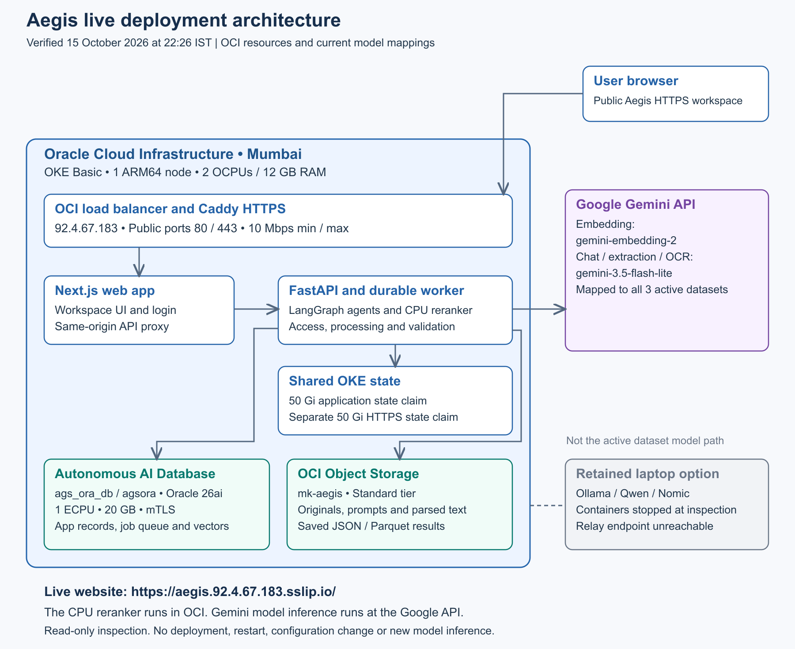

# Aegis live OCI architecture

Verified 15 October 2026 at 22:26 IST. Current documentation branch: `ags_sprint1`.

## Aegis live OCI architecture

Prepared for Swamy. The live environment was inspected using authenticated OCI access and read-only Kubernetes and application queries on 15 October 2026 at 22:26 IST. This document describes the deployed Aegis system and its current cloud and local connections.

Aegis is running on Oracle Cloud Infrastructure in Mumbai. The web application, API, agents, worker and CPU reranker run on OKE. Oracle Autonomous AI Database 26ai stores application records, the durable job queue and native vector knowledge. OCI Object Storage holds the documents and saved result files.

The three active datasets currently use Google Gemini for embeddings, chat, extraction and OCR. These model calls leave the OKE backend for the configured Google API. The older laptop Ollama option remains registered, but its containers are stopped and the relay endpoint did not respond during this inspection.

| Runs where | Components currently used |
| --- | --- |
| OCI OKE | Next.js web app, Caddy HTTPS, FastAPI, LangGraph agents, durable worker and CPU reranker |
| OCI Autonomous AI Database | Application records, access, durable job queue and Oracle native vector knowledge |
| OCI Object Storage | Original documents, prompts, parsed content and saved JSON / Parquet results |
| Google cloud API | Gemini embeddings, chat, extraction and dataset-aware OCR for all three active datasets |
| Local laptop | Retained Ollama / Qwen / Nomic option; containers stopped and relay endpoint unreachable at the check |

The public HTTPS application returned 200. Both application deployments had one ready replica, and all five application containers were ready with zero restarts. The inspection did not deploy, restart, reconfigure, upload documents or invoke model inference.

## Live application architecture

Users open https://aegis.92.4.67.183.sslip.io/. The OCI load balancer forwards HTTP and HTTPS to Caddy, which provides TLS and forwards to the Next.js web application. The web application proxies authenticated API requests to the internal FastAPI service.

FastAPI and the worker use the external Autonomous AI Database and Object Storage. Dataset mappings select Gemini for model execution. The CPU reranker runs inside OCI; its configuration value local means execution in the backend environment, not execution on the laptop.

The live namespace is aegis-oci. Application services run on one ARM64 OKE worker node. The retained SSH sidecar does not make the stopped laptop models available.

## Verified OCI resources

These values were read from OCI and Kubernetes during the inspection. The database is the managed Autonomous AI Database service, not the stopped Oracle Free container on the laptop. Its live database version is 26ai and its compute allocation is 1 ECPU.

The two persistent claims each report 50 Gi in Kubernetes and are backed by OCI block volumes reporting 50 GB each. The worker also has a 50 GB boot volume, for 150 GB of allocated boot and block volumes. Database storage is a separate 20 GB allocation.

| OCI resource | Live configuration | Observed state |
| --- | --- | --- |
| Region and tenancy | Mumbai ap-mumbai-1; maniatramco | Authenticated access |
| OKE cluster | ags-aegis-basic; Basic; Kubernetes v1.36.4 | ACTIVE |
| Node pool | ags-aegis-a1-node-pool; 1 node | ACTIVE |
| Compute | VM.Standard.A1.Flex; ARM64; 2 OCPUs; 12 GB RAM | RUNNING / Ready |
| Autonomous AI Database | ags_ora_db / agsora; Oracle 26ai; 1 ECPU; 20 GB | AVAILABLE |
| Database configuration | Free Tier flag true; compute/storage autoscaling off; mTLS required | Read connection verified |
| Object Storage | mk-aegis; Standard; namespace bmyljaecivrj | Read configuration verified |
| Public load balancer | 92.4.67.183; flexible 10 Mbps minimum and maximum | ACTIVE |
| Application state | application-state; 50 Gi claim; 50 GB OCI volume | Bound / AVAILABLE |
| HTTPS state | https-state; 50 Gi claim; 50 GB OCI volume | Bound / AVAILABLE |
| Node boot volume | 50 GB; 10 VPUs per GB | AVAILABLE |
| Private image registry | ags-aegis-web, ags-aegis-backend, ags-aegis-ssh | All private |

The bucket currently reports ObjectRead public access and versioning Disabled. Those existing settings were observed and left unchanged. The database Free Tier flag does not establish that the complete OKE environment has zero cost.

## Running containers and storage connections

Deployment aegis-web contains web and https. Deployment aegis-api-worker contains api, worker and model-relay. Each deployment has one desired replica and one ready replica. Both use Recreate for updates.

The table shows configured resource requests and limits. A CPU value of 250m means one quarter of a core. These values are not current utilization; the cluster Metrics API was unavailable during the inspection.

| Container | CPU and memory request | CPU and memory limit |
| --- | --- | --- |
| api | 250m CPU; 768Mi | 1 CPU; 2Gi |
| worker | 500m CPU; 2Gi | 1500m CPU; 4Gi |
| model-relay | 25m CPU; 32Mi | 100m CPU; 128Mi |
| web | 150m CPU; 512Mi | 1 CPU; 1536Mi |
| https | 50m CPU; 64Mi | 250m CPU; 256Mi |

1. **Database connection.** The active destination is OCI database agsora through wallet alias agsora_low, using mTLS. The configured search provider is oracle and the queue provider is database.

2. **Content connection.** The active content destination is OCI Object Storage bucket mk-aegis in namespace bmyljaecivrj. Originals, parsed content, prompts and versioned results keep their saved storage routes.

3. **Persistent application state.** API and worker share /data on application-state. It holds protected configuration, routes, locks, archives, model files and bounded application cache. Wallet and OCI credential mounts are separate.

4. **HTTPS state.** Caddy uses the separate https-state claim for persistent certificate state. Only the public entry is exposed for normal user access; FastAPI is an internal ClusterIP service on port 8000.

One node and one replica per deployment describe the current installation. A future application rollout can interrupt service; no rollout was performed for this documentation update.

## Current AI models and local connections

All three active datasets map their Embedding, Chat and Extraction defaults to the Gemini registrations below. Dataset-aware OCR also resolves to the mapped Gemini extraction registration. Global Ollama defaults remain in configuration, but they do not override these saved dataset mappings.

| Role | Mapped model | Where it executes |
| --- | --- | --- |
| Embedding | gemini-embedding-2 | Google Gemini API |
| Chat | gemini-3.5-flash-lite | Google Gemini API |
| Extraction | gemini-3.5-flash-lite | Google Gemini API |
| OCR for mapped datasets | gemini-3.5-flash-lite | Google Gemini API |
| Candidate reranking | Configured CPU reranker | OCI API / worker; model files on shared state |

1. **Gemini connection.** The saved endpoint host is generativelanguage.googleapis.com. Embedding uses gemini-embedding-2; chat and extraction use gemini-3.5-flash-lite.

2. **Saved model limits.** The embedding registration has an 8192-token context limit. Chat has 32768 context tokens and 512 output tokens; extraction has 32768 context tokens and 8192 output tokens. These are saved application settings, not a vendor capacity claim.

3. **Reranker location.** The configured reranker is enabled in local CPU mode inside the OCI backend, with files at /data/models/reranker. Embeddings and generated answers still use the mapped Gemini API.

4. **Retained laptop option.** Qwen3 chat/extraction and Nomic embeddings remain enabled registrations. The local Ollama container and earlier laptop application/database/index containers are stopped. The internal Ollama relay endpoint was unreachable.

5. **OCR behavior.** For these Gemini-mapped datasets, OCR uses the saved Gemini extraction model. The retained Qwen vision setting belongs to the local alternative path; it is not the current dataset OCR model.

This check read registrations and mappings without issuing a new Gemini inference request or restarting local models. Model availability and provider quota were not tested by making a paid processing call.

## Developed document and answer workflows

1. **Workspace and access.** Administrators manage users, passwords, roles and dataset assignments. The API checks the signed-in user and selected dataset/document scope before access.

2. **Dataset and prompt setup.** A dataset maps its model roles. Prompt templates define the fields and validation rules for extraction. Template versions remain associated with saved results.

3. **Confirmed document upload.** The user confirms the target dataset, documents and required external-processing consent. Original bytes are saved in OCI Object Storage and durable jobs are recorded in Autonomous AI Database.

4. **Parsing and indexing.** The OCI worker reads the originals, parses text and uses the mapped Gemini model for OCR when needed. Gemini embeddings are published into Oracle native vector knowledge with document and page references.

5. **Structured extraction.** The worker retrieves and reranks evidence, calls Gemini with the saved prompt, validates the structured response, then saves versioned JSON and Parquet results and publishes result knowledge.

6. **Review and export.** Users compare saved fields with original documents, correct values and mark a result Reviewed to save and lock it. Exports use saved data. Re-extract creates another result while preserving earlier versions.

7. **Unified Chat.** Every question follows access and scope checks, hybrid vector and keyword retrieval, CPU reranking, Gemini answer generation, and answer/citation validation. Aegis help follows the same retrieval path. Exact counts use complete authorized catalog facts.

8. **Recovery.** Accepted worker jobs persist beyond the browser. Progress comes from saved job state. Retries recover the accepted workflow and knowledge publication rather than silently submitting duplicate processing.

The inspection verified configuration and service readiness. It did not run a new upload, extraction, chat question, account change or recovery action.

## Versions observed in running services

The application versions below were read from the running containers. Kubernetes and Oracle Database versions were read from live OCI and node information. This page intentionally focuses on deployed technologies and omits package and library dependency inventories.

| Running technology | Observed version | Location |
| --- | --- | --- |
| Oracle Autonomous AI Database | 26ai | OCI managed database |
| OKE Kubernetes | v1.36.4 | OCI Mumbai |
| Worker operating system | Oracle Linux Server 9.8 | OCI ARM64 node |
| Node.js | 22.23.3 | OCI web container |
| Next.js | 15.5.27 | OCI web container |
| React | 19.3.0 | OCI web container |
| Python | 3.12.15 | OCI API and worker image |
| FastAPI | 0.142.2 | OCI API container |
| LangGraph | 1.2.14 | OCI backend agent runtime |
| Caddy | 2.10.2 | OCI HTTPS sidecar |

The currently mapped model identifiers are gemini-embedding-2 and gemini-3.5-flash-lite. Cloud model identifiers are saved provider selections rather than installed weight versions. Full deployed image references are preserved in the live resource record.

## Network operations and verification record

The VCN is ags-aegis-vcn with CIDR 10.42.0.0/16. Its API, worker and load-balancer subnets are 10.42.0.0/24, 10.42.1.0/24 and 10.42.2.0/24. The load balancer exposes ports 80 and 443 at 92.4.67.183. The application uses HTTPS and returned the HSTS header.

The internal API service uses port 8000. The retained Ollama service uses port 11434, and the restricted SSH relay service uses NodePort 32022. The relay sidecar is ready, while the laptop model endpoint is unavailable. No model port was opened or network policy changed during the inspection.

The database is available, mTLS is required, and both database compute and storage autoscaling are disabled. The database records the queue and native vectors in the same managed service. The bucket is Standard storage; original documents and complete result files remain in Object Storage.

OCI API calls were GET/list operations. Kubernetes reads inspected nodes, deployments, pods, services and persistent claims; read-only commands inside existing containers checked versions and configuration. The application catalog query explicitly used a read-only database transaction and bypassed cache writes.

The resource record includes current resource names, allocated capacity, container requests/limits, active model mappings, observed versions and deployed image digests. Credentials, wallet files, private keys, user documents and result payloads are excluded.

| Repository reference | Purpose |
| --- | --- |
| OCI-LIVE-RESOURCES.md | Readable live resource inventory |
| OCI-LIVE-SNAPSHOT.json | Sanitized inspection snapshot and image references |
| ARCHITECTURE.md | Text companion to this Word architecture document |
| TECH-STACK.md | Observed running technologies and model placement |
| DEPLOYMENT.md | Instructions for a future authorized application release |
| Branch ags_sprint1 | Current manager handover and documentation updates |

The deployed image references were recorded before and after the documentation work. The existing source freeze tag is preserved; this update changes documentation on ags_sprint1 and does not redeploy the application.
