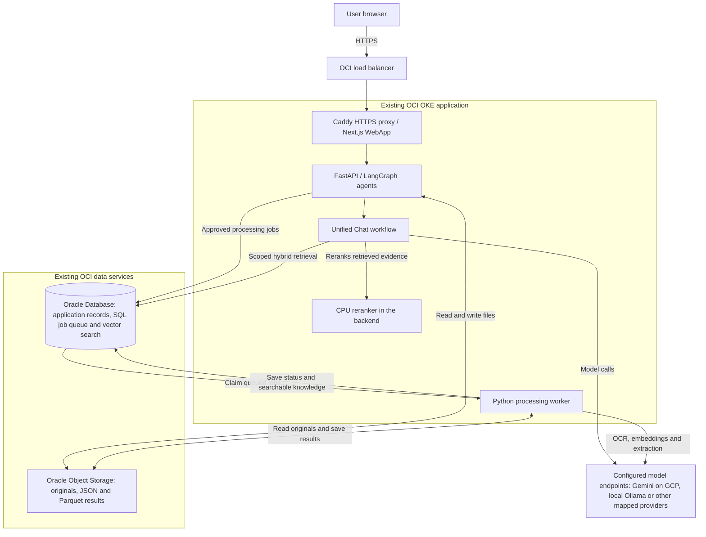

# Aegis

Aegis turns documents into searchable knowledge and structured, reviewable results. It uses a Next.js/React interface, FastAPI, LangGraph agents and a durable Python worker.

**Handover branch: `ags_sprint1`. Current working version: `v26.1.2.2` (base: `v26.1.0.0`).** The original source freeze remains tagged `aegis-freeze-2026-10-15`; use the handover branch for subsequent updates.

## Dashboard chat view

Including indexed dataset knowledge opens a larger Dataset Knowledge Chat and collapses the dataset cards, Sources and guidance. The selected knowledge summary and **Add Dataset Knowledge** stay available. Use the source-panel icon to inspect or edit sources, and the expand/collapse icon to switch between the larger chat and full Dashboard. These controls have descriptive tooltips and accessible labels. Layout changes keep your draft, selected knowledge and conversation; opening chat sends no question automatically.

Frontend v26.1.2.2 was deployed to the existing Mumbai OCI application on 19 October 2026 from source commit `147adb9f9c7a5a1049061c8045953897a7011760`, release `release-20261019-192624-b8d433`. The production image, rollout, preserved configuration, HTTPS and seven live script assets passed; the served assets include v26.1.2.2. This approved Sprint1 frontend omits the separate governance screens. The existing backend, saved settings, database, models and data remain unchanged. Authenticated live Dashboard interaction requires sign-in and was not verified; no live inference or upload/extraction write test was run. Private deployment evidence remains outside Git; see [CHANGELOG.md](CHANGELOG.md) for the source fingerprint and image digest.

## Metadata Relationships

Open **Dashboard → Metadata Relationships** from the top-right of the Knowledge Source header. The graph opens on demand for the Dashboard's selected datasets and can include other accessible datasets, including inactive ones. It shows datasets, documents, extraction runs, saved prompt versions, review revisions and model mappings. Search records, explore categories, inspect connections, switch graph/list views and open an original document or extraction in Review. The graph uses Aegis blue and navy on a light canvas to match the Dashboard.

The endpoint is read-only and does not run chat, inference, knowledge indexing or provider connection tests. Combined extraction lineage uses the saved document list. Current model mappings and pinned extraction model versions are separate links. Graph rendering is bounded; category totals and paginated matching records disclose larger scopes. Relationships come from the authorized metadata catalog and saved record snapshots, independently of the vector store used for knowledge retrieval. No new database tables or Neo4j service are required. Version v26.1.2.0 was published to the existing Mumbai OCI application on 18 October 2026 from commit `1280406c365de7b429ece2c989474110c34321b7` (release `release-20261018-111729-f3a940`). Web, API and worker rollouts, preserved configuration/schema, readiness and HTTPS checks passed. Private receipts are retained under `ags_deploy/deployment-records/`; no database DDL was performed.

## Start here

| Need | Maintained reference |
| --- | --- |
| Architecture, technology stack, workflows, approved Mural diagram and model placement | [Architecture handover PDF](ags_docs/Aegis_Architecture_Handover.pdf) or [editable Word document](ags_docs/Aegis_Architecture_Handover.docx) |
| Provisioning prerequisites and initial installation handoff | [OCI deployment guide](ags_docs/Aegis_OCI_Deployment_Guide.pdf), Section 1, pages 2-7 |
| Windows workstation setup, destination JSON, build and deployment commands | [Windows deployment README](ags_deploy/README.md); deployment PDF pages 10-11 and 15 |
| AI-assisted prerequisite setup and deployment | [Aegis deployment agent skill](.agents/skills/aegis-deploy/SKILL.md) |
| Database scripts and object release behavior | [Database README](ags_database/README.md) |
| Local development and runtime launchers | [Local-use README](ags_local_use/README.md) |
| Automated tests, fixtures and manual QA | [Testing README](ags_testing/README.md) |

The two PDFs above are the documents to share for architecture/technology and provisioning/deployment. Deployment PDF Section 2 (pages 8-18) includes the workflow on page 9, Windows and Cloud Shell instructions, component selection, approvals, verification and recovery. Provisioning and initial application configuration are separate from the code/object release scripts and deployment skill.

## Architecture diagram

GitHub renders this overview directly in the README. The approved detailed Mural diagram follows it.



Original Aegis Agent Unified Chat and Dashboard knowledge-grounded answers follow **scope/access checks -> hybrid retrieval -> CPU reranking -> model generation -> answer and citation validation**. Dashboard greetings, small talk and clearly self-contained general questions use the selected Chat model directly, without a knowledge lookup. Processing jobs retain their confirmation and external-data consent requirements. Model providers follow saved dataset mappings; the diagram does not imply all providers are running or required.

### Approved detailed architecture


[Open the full-resolution diagram](ags_docs/assets/aegis-architecture.png). This is the approved Mural diagram reused from the [architecture handover](ags_docs/Aegis_Architecture_Handover.pdf). Its provisioned-services configuration snapshot is dated **15 October 2026**; cloud provider blocks show supported hosting alternatives. Effective model connections follow each environment's saved dataset mappings.

## Prerequisites before deployment

The normal Windows workflow is **Setup-Aegis.ps1, then Deploy-Aegis.ps1**. Have these ready first:

- An open Windows PowerShell 5.1 or newer window and a local Aegis Git checkout with saved, validated source files.
- App Installer / WinGet and internet access for missing tool installation. For application releases, a workstation that supports Docker Desktop Linux containers, installer/UAC access when required, and at least 10 GiB free on the source/work drive. Actual images/builds can require more space.
- An **existing prepared OCI environment** with compatible Aegis workloads, database access, persistent state, storage, Secrets, required model/reranker assets and HTTPS routing as applicable. A bare OKE cluster or new tenancy is insufficient.
- Your destination's usable kubeconfig/context, authorized OCI authentication and registry access; a database wallet and authorized credentials when database objects are selected.
- A filled private destination JSON and truthful test/CI evidence for the source being released. Keep passwords, tokens, private keys and wallets out of Git, JSON, command arguments and logs.

Normal setup reuses working tools and installs supported missing Git, Python 3.12, kubectl and Docker Desktop through WinGet as applicable. It creates a missing project `.venv`, installs an isolated OCI CLI if kubeconfig authentication needs it, and the pinned Oracle driver for database object releases. WSL/Docker setup, private login, UAC and restart prompts can require operator action. It cannot provide credentials, grant OCI access or create the destination resources. It does not restart Windows automatically.

Setup does not clone the repository. If Git is needed before cloning, follow the [manual tool installation commands](ags_deploy/README.md#manual-reference-install-missing-workstation-tools), install Microsoft's App Installer first if WinGet is unavailable, then reopen PowerShell. Local Node/npm installation is needed for local frontend development/testing, while deployment installs application dependencies inside the maintained Docker images.

## Windows quick start for a colleague

### 1. Obtain the source

If you do not already have a checkout, run in a directory where a new `Aegis` folder can be created:

```powershell
git clone --branch ags_sprint1 https://github.com/Maniatramco/Aegis.git
Set-Location .\Aegis\ags_deploy
```

For an existing checkout, open its `ags_deploy` folder instead. Review any saved local changes before deploying; do not overwrite the checkout or reset someone else's work.

### 2. Prepare your environment's private JSON

Run from `ags_deploy`. Create the destination file from the [clean non-secret template](ags_deploy/templates/deployment-inputs.example.json), then edit it:

```powershell
New-Item -ItemType Directory -Path 'C:\aegis-target' -Force
if (-not (Test-Path -LiteralPath 'C:\aegis-target\colleague-oci.json')) {
    Copy-Item -LiteralPath '.\templates\deployment-inputs.example.json' -Destination 'C:\aegis-target\colleague-oci.json'
}
notepad 'C:\aegis-target\colleague-oci.json'
```

Fill the local source path (or leave `SourcePath` blank), component selections, destination kubeconfig/context/namespace, registry, platform, public URL and validation evidence. Fill the database identity/wallet fields when `DB_Object` is `Y`. Use your own prepared environment's values and credentials. The template initially selects database objects and both application components; review every `Y`/`N` before running it. See the [field descriptions and component examples](ags_deploy/README.md#prepare-the-target-json).

Keep a separate private JSON for each tenancy/cluster. Use the **same file on both commands** below. If `-Inputs` is omitted, the scripts use the ignored `ags_deploy/aegis-oci-inputs.json` beside them. Filled destination files are private operator state, not distributable templates.

### 3. Run prerequisite setup

```powershell
.\Setup-Aegis.ps1 -Inputs 'C:\aegis-target\colleague-oci.json'
```

Complete installation/credential prompts and type `CONNECT` when asked to authorize remote read-only checks. Setup checks the selected source, tools, target access, registry metadata and schema/configuration as applicable. It does not build or publish images, apply database DDL, update workloads or run application regressions.

Continue only after successful completion prints **`AEGIS_PREREQUISITES_READY`**. If setup stops, inspect its exact printed report, resolve the stated issue and rerun the same setup command. Complete any requested Windows restart yourself before retrying. The marker confirms checks at that time; it does not guarantee image build, registry push or rollout success.

### 4. Build and deploy

```powershell
.\Deploy-Aegis.ps1 -Inputs 'C:\aegis-target\colleague-oci.json'
```

The release performs **CONNECT -> preflight -> selected image builds -> saved plan -> PUBLISH -> release -> verification**. Review the exact source, destination, images, database action and restart impact in the printed `plan.json` before typing `PUBLISH`. There is no additional manual application build command. Setup and deployment never auto-answer approval words.

## The two Windows invocation methods

Both methods use the same prerequisite setup, target JSON and maintained release workflow. Run from `ags_deploy`; choose one release command per run.

| Method | Optional read-only release preflight | Build and release |
| --- | --- | --- |
| Main script | `.\deploy.ps1 -Inputs 'C:\aegis-target\colleague-oci.json' -CheckOnly` | `.\deploy.ps1 -Inputs 'C:\aegis-target\colleague-oci.json'` |
| Shortcut scripts | `.\Check-Aegis.ps1 -Inputs 'C:\aegis-target\colleague-oci.json'` | `.\Deploy-Aegis.ps1 -Inputs 'C:\aegis-target\colleague-oci.json'` |

The shortcuts call `deploy.ps1` and pause so the result can be read. A release already includes target preflight; a separate `Check-Aegis.ps1` invocation is optional. `Setup-Aegis.ps1 -CheckOnly` checks prerequisites without installing tools, creating a virtual environment, starting Docker or performing registry login; it still requires permission for remote read-only checks and writes local reports.

## Saved source, component selection and database behavior

Each normal Windows release snapshots saved local application/database source and the maintained release helper, including non-ignored new files and saved deletions. No Git commit or JSON `Ref` update is required. Private state, credentials, ignored new files, generated output and the `delete/` archive are excluded. The plan records `source_mode: working-tree`, the base commit, snapshot fingerprint and `source-manifest.json`; the saved snapshot is the actual build input. Save and validate intended edits before starting. Later edits go into a subsequent run.

Each invocation runs the selected Docker builds; unchanged layers may use cache. Saving a file alone does not trigger a deployment. For an explicitly committed-source release, add `-CommittedSource` to both setup and deployment; only that mode exports the JSON `Ref` and excludes uncommitted edits.

| Release | `DB_Object` | `DeployFrontend` | `DeployBackend` |
| --- | --- | --- | --- |
| Frontend and backend code, no database DDL | N | Y | Y |
| Frontend only | N | Y | N |
| Backend API and worker only | N | N | Y |
| Database objects only | Y | N | N |

All N is rejected. `DB_ReleaseFile` normally selects [ags_database/release.json](ags_database/release.json). Matching objects are preserved, listed supported missing objects can be created after approval, and incompatible existing definitions stop the release. The file can explicitly permit a missing app user/schema inside the existing database; show its grants/quota and objects in the final plan before approval. Existing accounts, settings, objects and data remain intact. This is not infrastructure provisioning, a data import or an arbitrary migration runner.

Database-only releases do not require Docker or Kubernetes. With database objects disabled, a backend release still needs read-only schema compatibility and active-job checks; frontend-only releases make no Oracle queries. Use private password prompts. A backup reference is optional and is not required or prompted for.

## Deployment agent skill

The shareable agent skill is included in this repository at [.agents/skills/aegis-deploy/SKILL.md](.agents/skills/aegis-deploy/SKILL.md), with its [agent metadata](.agents/skills/aegis-deploy/agents/openai.yaml). It covers workstation setup, private target inputs, saved-source builds, plan approval, verification and failure handling. Ask your agent:

> Use the repository's aegis-deploy skill to prepare my Windows prerequisites, verify the destination in my private target JSON, and build and deploy Aegis after I approve the exact release plan.

Give the agent your actual checkout and private JSON paths; provide secrets through private prompts rather than chat. Approve read-only connection scope and the exact publication plan separately. The skill uses the same maintained scripts and prepared-resource boundary as the manual route. The [aegis-release skill](.agents/skills/aegis-release/SKILL.md) covers source freezes and handover maintenance.

## Verify the outcome and handle stops

A completed application release prints `Release completed; configuration checks passed`, the application URL, exact receipt/record paths and exit code 0. A successful setup or `-CheckOnly` run is not a deployment. Database-only releases report their database result without claiming an application rollout. Retain the exact plan, result and receipt printed by that invocation; do not pick a guessed or latest record.

Setup reports are under `ags_runtime/deployment-setup/setup-.../result.json`; release records are under `ags_deploy/deployment-records/release-.../`. They remain ignored by Git. Read the [outcome and troubleshooting sections](ags_deploy/README.md#confirm-the-outcome) for commands and common failures, including missing approval, hidden/closed terminals and Docker/authentication issues.

Releases preserve infrastructure, configuration, model mappings, persistent state and unselected components. Selected Recreate deployments restart pods and can briefly interrupt service. On failure, inspect completed phases and actual images before proposing recovery. There is no automatic retry or rollback. Setup/deployment do not run regression, upload/extraction or model inference tests; supply truthful source validation evidence and run only authorized acceptance checks.

## Application version and Connections footer

The current version and in-app release notes are defined in [application-version.json](ags_frontend/app/application-version.json). The compact footer shows **Connections** and **v26.1.2.2**; hover, focus or click Connections to inspect service details. AI model hosting is derived from authorized dataset defaults: Gemini is labeled GCP, Ollama Local, and mixed connections can show Local / GCP. This metadata is not a provider health test or a change to model registrations. Open **About** from the sidebar or click the footer version to see what each version includes. The project change history is maintained in [CHANGELOG.md](CHANGELOG.md); it distinguishes included code from a verified live deployment.

Dashboard opens a knowledge workspace with onboarded dataset cards, **Sources** on the left and an expanded **Dataset Knowledge Chat**. This read-only chat is separate from **Aegis Agent V2**: it uses `/api/dataset-chat/*`, its own `dataset_chat` conversations and browser storage. It cannot create Agent plans, goals, uploads, extractions or re-extractions. The existing Aegis Agent keeps its original component, routes, selectors, tools and history; open it from navigation or the Agent shortcut for processing. Dataset cards set the dashboard chat scope, so no duplicate dataset selector is shown. **All accessible knowledge** supports questions across accessible datasets. Dashboard loads the dataset cards and sources first; chat initializes only after a dataset is chosen or **Open chat** is clicked. Opening Dashboard, opening chat and changing source scope never generate an automatic summary; model requests start only when the user sends a question. Greetings and clearly general questions get a brief model answer without resolving embeddings or searching knowledge. Mixed, dataset-specific, application-specific and uncertain questions keep the full grounded path. Direct replies are marked as general answers with no knowledge lookup or invented citations. **Add Dataset Knowledge** stays in a sticky toolbar outside the scrolling Sources list, including when Sources is collapsed. Use the dataset-card checkboxes to combine multiple datasets, or drag a dataset card onto Sources to include its accessible indexed files. Existing file exclusions remain excluded when adding a different dataset; stale, unindexed and inactive sources cannot be added. An empty selection stays empty. The picker supports multiple datasets and individual indexed files without uploading or duplicating originals. Retrieval rechecks grants, searches each embedding space separately, reranks evidence, generates the answer and validates citations. Empty file selections and revoked access cannot widen the scope. Each answer shows a compact status with distinct knowledge sources checked and cited. Expand it for the source-type breakdown and actual workflow details. Multiple passages from one document count once; saved results and dataset descriptions are separate knowledge sources. Counts describe retrieved evidence, not every file in the selected datasets. Sources can collapse. The continuous workflow guide remains below. The displayed page and navigation label is **Dashboard**, with existing Home links retained as aliases.

Dataset creation remains in the original Dataset workspace: use **Onboard → Dataset → New dataset** to open its existing inline onboarding form. The separate Onboard dataset page and navigation entry have been removed; its old URL resolves to Dataset. The original Aegis Agent onboarding, upload, extraction and re-extraction workflows are unchanged. Dashboard has no onboarding action.

## Additional OCI route and current limitation

The separate Cloud Shell route uses committed source, Linux paths and Podman. It is not one of the two Windows invocation methods above. See deployment PDF pages 16-17 for preparation and execution:

```bash
bash ./ags_deploy/cloud_shell/deploy-cloud-shell.sh --inputs ~/aegis-private/target.json
```

Add `--check-only` for read-only preflight. Native architecture, disk space, remaining Cloud Shell allowance, existing registry login and applicable private database wallet/driver must be checked. The route does not provision infrastructure or choose a paid fallback. OCI DevOps managed build runners are not enabled by these Windows/Cloud Shell scripts.

**Recorded Mumbai limitation, 16 October 2026:** the existing OKE API rules rejected the Cloud Shell public connection. Network settings were kept unchanged. This target requires an authorized connection that passes preflight before any publication; do not infer availability from this historical note or change firewall rules as part of a code release.

## Source layout, technology and validation

Application code lives in `ags_backend/` and `ags_frontend/`; native Oracle scripts in `ags_database/`; release/authentication helpers in `ags_deploy/scripts/` and `ags_deploy/ags_oke/`; local runtime options in `ags_local_use/`; and automated tests, fixtures and QA tools in `ags_testing/`. Preserve the [Unified Chat workflow](AGENTS.md): enforce scope, hybrid retrieval, reranking, generation and answer/citation validation.

The release Dockerfiles retain immutable Python 3.12.15 and Node.js 22.23.3 base digests and committed dependency locks. The OCI backend profile includes Oracle/OCI and native AWS/Google SDKs, with local in-process embeddings disabled. Existing model files, mappings, endpoints and runtime configuration are preserved. The architecture handover records observed technology versions and deployment placement; a documentation/GitHub push does not update the running application.

Use the maintained files linked above rather than superseded guide names. Any historical `delete/` archive stays outside builds and active test discovery. Private state, generated reports, wallets and release records stay out of Git.

For manual validation, follow [ags_testing/README.md](ags_testing/README.md). From the repository root with a supported project Python environment:

```powershell
.\.venv\Scripts\python.exe -m pip install -r ags_testing\backend\requirements.txt
.\.venv\Scripts\python.exe -B ags_testing\run_backend_tests.py
```

The backend runner uses temporary SQLite storage and mock providers in a child process. For frontend validation, install dependencies once with `npm --prefix ags_frontend ci`, then run:

```powershell
npm --prefix ags_frontend run test:unit
npm --prefix ags_frontend run typecheck
npm --prefix ags_frontend run build
```

These local checks do not deploy or establish live OCI/provider acceptance. Use the testing guide for deployment guard tests and opt-in integration checks; report actual results for the source being released.
