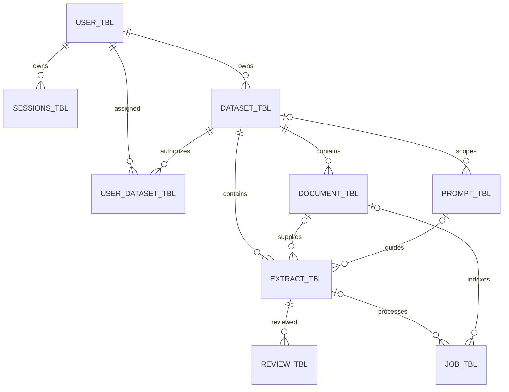
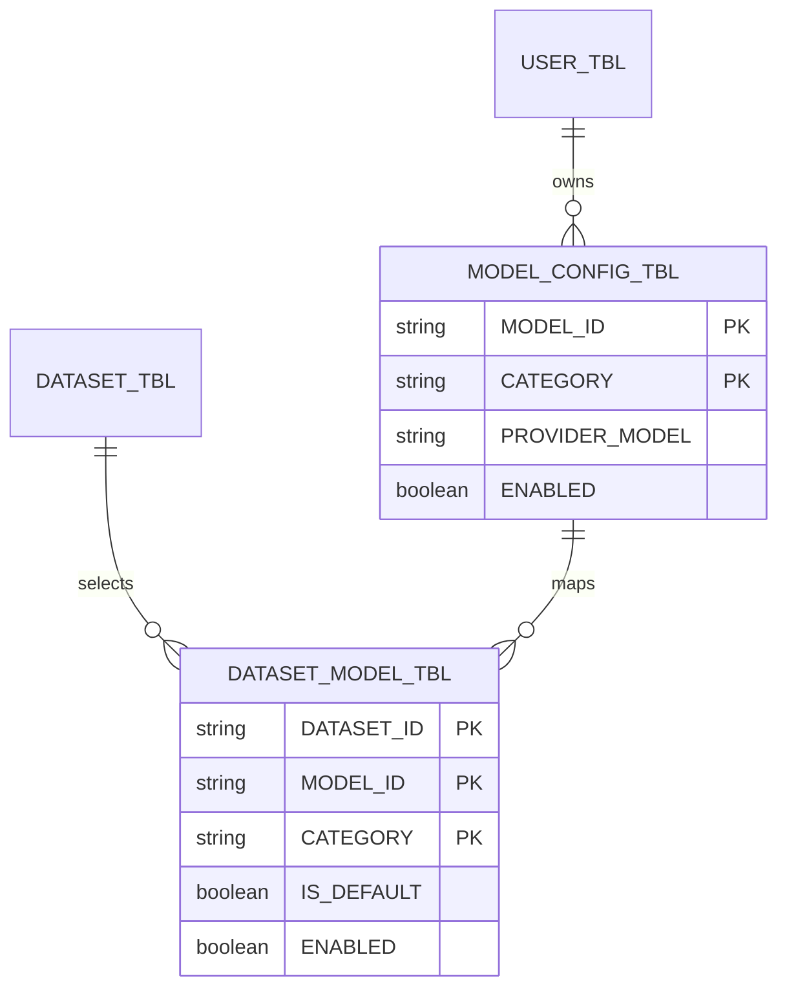

# OCI Oracle database installation and live schema reference

For one step-by-step guide from creating a new OCI Autonomous AI Database through
schema deployment and verification, use the
[database deployment PDF](../ags_docs/Aegis_OCI_Database_Deployment_Guide.pdf).

`ags_database/` contains native Oracle SQL aligned with the deployed `agsora`
Autonomous AI Database in `ap-mumbai-1`. Read-only inspection on
16 October 2026 at 00:18 IST (15 October at 18:48 UTC) confirmed owner `ADMIN`, mTLS wallet alias
`agsora_low`, and all thirteen application tables. OCI identifies
the database as Oracle 26ai; the connected server reports `23.26.4.1.0`.
No application data or credentials are included in these scripts.

Local Oracle Free owner creation, the SQLAlchemy-based local DDL generator,
its twelve-table installer and generated SQL now live under
[`ags_local_use/ags_database/`](../ags_local_use/ags_database/).
SQLAlchemy remains part of the live backend's Oracle access layer. Moving the
local tooling does not remove or replace that runtime dependency.

## Files and responsibilities

| Folder or file | Purpose |
| --- | --- |
| `ags_tables/` | Thirteen Oracle table definitions read from live metadata, including native vectors |
| `release.json` | Ordered object-release file for `DB_Object: "Y"`; permits creation of a missing application user/schema, skips matching objects and stops on incompatible definitions |
| `deploy-oci-database.ps1` | SQLcl deployment launcher using an explicit destination wallet, account, alias and full service |
| `install.sql` | Guarded fresh installer with target, capability and completed-schema checks |
| `ags_schema/verify_live_schema.sql` | Read-only connection, table, column, constraint and vector checks |
| `ags_queries/` | Read-only workflow, account and dataset-access inspection using the connected owner |

## Deploy the schema to another OCI database

For the current one-command workflow, use `ags_deploy/deploy.ps1` with `DB_Object:
"Y"` and `DB_ReleaseFile: "ags_database/release.json"` in the destination JSON.
Set frontend/backend to `"N"` for database-only execution. The root
[one-command instructions](../README.md#deploy-with-one-command) describe private
credentials, missing-schema creation, release-file paths, approval and matching
object checks. That workflow uses the existing Oracle Python driver and the
explicit script list; it creates no OCI database instance or infrastructure.

The SQLcl commands below remain the alternative **fresh, empty-owner** installer;
they do not create users or replay an initialized schema.

These scripts install the current thirteen-table application schema in a
**separate, empty owner on a prepared Oracle Autonomous AI Database 26ai**.
The destination can have a different tenancy, region, database name, account
and wallet alias. Nothing in the installer connects to `agsora` automatically.
It does not provision OCI resources or copy existing records, files or users.

### 1 Prepare the destination account

Have the destination DBA create a dedicated application owner, for example
`AGS_APP`, with a private password, `CREATE SESSION`, `CREATE TABLE`, a default
tablespace and enough available quota. On Autonomous Database that tablespace
is normally `DATA`. Create the user through Database Actions or your approved
account provisioning process; do not put passwords in SQL files or Git.
The DBA can apply these statements to the **new destination only**, replacing
the example owner and selecting an appropriate quota:

```sql
GRANT CREATE SESSION, CREATE TABLE TO AGS_APP;
ALTER USER AGS_APP DEFAULT TABLESPACE DATA QUOTA 200M ON DATA;
```

The 200 MB quota is an installation example, not production capacity sizing.
Use an owner without existing objects; enabling optional user features can
create objects, in which case prepare a separate empty owner. Oracle documents
[Autonomous account creation and DATA quota](https://docs.oracle.com/en/cloud/paas/autonomous-database/serverless/adbsb/manage-users-create.html).

The database must support SQL `BOOLEAN`, native `VECTOR` and the observed
data-bound collations. The collation definitions require
`MAX_STRING_SIZE=EXTENDED` and compatible database settings. The installer
checks capabilities with read-only probes and stops when they are unavailable;
it never changes database-wide settings. Refer any prerequisite failure to the
destination DBA. See Oracle's
[collation requirements](https://docs.oracle.com/en/database/oracle/oracle-database/26/nlspg/database-globalization-support-guide.pdf)
and [MAX_STRING_SIZE reference](https://docs.oracle.com/en/database/oracle/oracle-database/26/refrn/MAX_STRING_SIZE.html).

### 2 Connect using the destination wallet

Obtain the new database's wallet and permitted network access. Keep wallet
files outside the repository and use the new owner's credentials. In a full
checkout of `ags_sprint1`, start SQLcl **with `ags_database` as its working
directory** so all nested scripts resolve:

```powershell
Set-Location .\ags_database
sql /nolog
```

In SQLcl, replace the path, owner and wallet TNS alias below. Enter the password
at the client prompt; do not include it in the command:

```sql
SET CLOUDCONFIG C:\aegis-target\Wallet_NEWDB.zip
CONNECT AGS_APP@NEWDB_low

SELECT USER AS connected_owner,
       SYS_CONTEXT('USERENV','CURRENT_SCHEMA') AS current_schema,
       SYS_CONTEXT('USERENV','SERVICE_NAME') AS full_service_name
FROM dual;
```

Compare the result with the intended destination. `NEWDB_low` is only the
wallet alias; the returned full service name is the installer's second
argument. Confirm that name against the new wallet's `tnsnames.ora` service
descriptor. Oracle's [SQLcl wallet connection instructions](https://docs.oracle.com/en-us/iaas/autonomous-database-serverless/doc/connect-sqlcl.html)
describe this connection flow. SQL*Plus can also run the installer once its
destination wallet connection is configured; `SET CLOUDCONFIG` is SQLcl-specific.

### 3 Install once in the verified empty owner

The deployment launcher can be called from any working directory. From the
repository root, first validate the package and destination wallet locally:

```powershell
.\ags_database\deploy-oci-database.ps1 `
  -WalletPath 'C:\aegis-target\Wallet_NEWDB.zip' `
  -UserName 'AGS_APP' `
  -ServiceAlias 'NEWDB_low' `
  -ExpectedService 'YOUR_FULL_SERVICE_NAME.adb.oraclecloud.com' `
  -CheckOnly
```

`-CheckOnly` starts no SQL client and makes no database connection. When a
deployment to the confirmed new target is authorized, run the same command
without `-CheckOnly`. SQLcl must be installed (`sql` on PATH, or supply
`-SqlclPath`). It prompts for the password, uses `install.sql`, and requires
both a successful client exit and the completed-schema success marker. The
script prints the installation log path; it does not put a password in a
command, generated SQL file or log. `-WhatIf` previews the operation locally.

For an already connected SQLcl or SQL*Plus session, the manual equivalent is
below. The client must have `ags_database` as its working directory.
Only when you intend to install into that new destination, replace both values
with the confirmed owner and **full server service name**:

```sql
@install.sql AGS_APP YOUR_FULL_SERVICE_NAME.adb.oraclecloud.com
```

The installer rejects a different connected owner/current schema, a different
service, SYS/SYSTEM connections, a nonempty schema, missing table privileges,
missing quota or unsupported Oracle features **before creating a table**.
It creates the thirteen tables in foreign-key order, then requires the expected
column counts, constraints, application indexes and native vector column.
Success prints `AEGIS_SCHEMA_INSTALL_OK` and exits the client with status zero.
SQL/OS errors and failed checks exit unsuccessfully.

Keep the complete `ags_database` directory together. SQL*Plus command errors
are not all covered by `WHENEVER SQLERROR`; inspect the output as well as the
exit status and require the final success marker. A failed/partial install
must be reviewed in that destination. Oracle DDL commits implicitly, so earlier
table creation is not undone by `ROLLBACK`. This installer never drops objects
or retries over an existing schema. See Oracle's
[SQL error handling reference](https://docs.oracle.com/en/database/oracle/oracle-database/26/sqpug/WHENEVER-SQLERROR.html).

### 4 Verify and complete the application handoff

Reconnect to the same destination owner and run this read-only check, still
from `ags_database`:

```sql
@ags_schema/verify_live_schema.sql
```

Expect thirteen `PRESENT` tables, 165 columns in total, enabled constraints,
twenty application indexes in addition to Oracle-managed indexes, an
`EMBEDDING` column of type `VECTOR`, and identical-vector distance zero.
The script also prints the connected owner and service for the release record.

The result is an empty database schema. Complete the new installation's wallet,
encrypted database configuration, storage, encryption key and model handoff
using the existing [OCI deployment guide](../ags_docs/Aegis_OCI_Kubernetes_Deployment_Guide.docx).
Create the initial workspace administrator through the new application's
bootstrap flow. No old application accounts, documents, registrations or
credentials are seeded by these SQL files. A code-image release is a separate
operation from schema installation.

### Validation performed

The fresh read-only live metadata comparison at the time above matched all
thirteen SQL files, including column order/types/defaults/nullability,
collations, primary/unique/foreign/check constraints, foreign-key delete rules,
native vector format and application index definitions. Only owner qualification
and Oracle-managed physical storage clauses are omitted for destination portability.

On 16 October 2026, the installer completed against a disposable local Oracle AI Database 26ai
Free `23.26.3.0.0` instance with extended strings enabled. All thirteen tables,
165 columns, thirteen primary keys, two unique constraints, 49 foreign keys,
131 check/NOT NULL constraints and twenty application indexes passed the final
checks. A repeat install was rejected. Wrong-owner, wrong-service,
missing-privilege, missing-quota and incompatible-collation cases also stopped
before creating objects. The disposable instance was removed.

This validates native SQL execution and the guards on that Oracle version;
it is not a deployment to a second OCI tenancy. The new OCI destination must
pass its own connection, prerequisites and application checks when deployment
is explicitly requested. No installation SQL was run on live `agsora`.

## Inspect an existing installation safely

For the current live database, use a fresh connection and read-only verification
only. The observed connection uses `agsora_low` and owner `ADMIN`. From the
repository root, run:

```sql
@ags_database/ags_schema/verify_live_schema.sql
```

The script reads schema metadata and checks native vector support. The diagnostic
queries use unqualified application table names, so they run in the connected
schema rather than assuming the old local `AGS_OWNER` schema.

`install.sql` and `ags_tables/*.sql` are fresh installation scripts for a
separate prepared owner. They are not upgrade scripts for the populated live
database. Review any schema changes to an existing workspace separately.

The SQL preserves the observed 165 columns, defaults, collations, primary/unique/
foreign/check constraints and twenty application indexes. Schema qualification
and Autonomous Database managed physical storage clauses are omitted so a
reviewed destination can use its own owner and storage defaults. LOB/system and
constraint-backed indexes are managed by Oracle rather than duplicated as
separate application index statements.

The local-only generator writes exclusively inside `ags_local_use/ags_database/`;
it cannot overwrite this OCI schema reference. Local setup and the legacy
`AEGIS` to `AGS_OWNER` procedure are documented in
[`ags_local_use/README.md`](../ags_local_use/README.md#local-database-tools).

## Tables and keys

| Table | Primary key | Purpose / main fields |
| --- | --- | --- |
| `USER_TBL` | `ID` | Username, password hash, role (user/administrator) and account audit |
| `SESSIONS_TBL` | `ID` | Hashed login token, owner, expiry and CSRF protection |
| `DATASET_TBL` | `DATASET_ID` | Owned dataset, name and status |
| `USER_DATASET_TBL` | `USER_ID, DATASET_ID` | User/dataset assignment, enabled flag and creation/update audit |
| `DOCUMENT_TBL` | `DOCUMENT_ID` | Dataset, filename, merged flag, storage reference, bytes and status |
| `PROMPT_TBL` | `PROMPT_ID` | Filename, version, schema reference, owner and optional dataset |
| `EXTRACT_TBL` | `EXTRACT_ID` | Dataset, document, prompt/version, result/version, status and error |
| `REVIEW_TBL` | `REVIEW_ID` | Extraction, reviewed input version, saved review version and result reference |
| `JOB_TBL` | `ID` | Indexing/extraction task, target, status, progress, attempts, lease and error |
| `MODEL_CONFIG_TBL` | `MODEL_ID, CATEGORY` | Model name, provider model, category, configuration reference, version and enabled flag |
| `DATASET_MODEL_TBL` | `DATASET_ID, MODEL_ID, CATEGORY` | Dataset/category model mapping, enabled and default flags |
| `AEGIS_ITEMS` | `ID` | Internal entity catalog: kind, owner, parent, reference, status and version |
| `AEGIS_KNOWLEDGE_VECTORS` | `COLLECTION_NAME, POINT_ID` | Native vectors, dimensions, payload and owner/dataset/document scope |

Core account/session/job keys retain the physical column name `ID` to preserve
existing application interfaces. Workflow entity IDs equal their catalog IDs;
they are not new IDs invented during migration. There is no separate `records`
table in the active Oracle schema: that legacy catalog is now `AEGIS_ITEMS`.

## Workflow relationships



Oracle enforces these foreign keys. Each owned workflow entity also references
`USER_TBL.ID`. Dataset/document/prompt/extraction/model configuration IDs reference
their catalog entry, with cascade deletion of their projection when that catalog
entry is deleted. The catalog's general `PARENT_ID` remains a compatibility field;
named workflow tables provide actual dataset foreign keys.

Global prompts have a NULL dataset. Document deletion sets extraction/job document
links to NULL while preserving historical extraction/job IDs. Prompt deletion sets
the extraction prompt link to NULL. Extraction deletion removes its reviews and
clears job extraction links. A job can have at most one of `DOCUMENT_ID` and
`EXTRACT_ID`; both may be NULL for deleted or historical targets. `TARGET_ID`
retains the original target string.

## Dataset permissions

`USER_DATASET_TBL` is a many-to-many mapping. Accounts with
`USER_TBL.ROLE = 'administrator'` manage accounts, assignments and dataset/model
configuration and access every dataset. Ordinary users see only enabled
assignments. Role changes preserve explicit assignments, revoke affected sessions,
and cannot remove the last administrator. Assigned users share dataset documents, scoped prompt templates,
extraction results, reviews and workflow jobs. Conversations and Agent plans
remain private to their creator and require continuing access to their dataset.
Global prompts remain owner-scoped.

Uploads and extraction jobs use the dataset's storage owner so model workers and
vector indexes stay consistent. `CREATED_BY` records the authenticated uploader
or requester, rather than treating the storage owner as the person who acted.
Each assignment has the standard creation/update timestamps, actor foreign keys
and source fields. Revocation disables a row without losing its creation audit;
reassignment enables that same row. Startup only grants legacy owners access
when the mapping table is first introduced, never after an administrator revokes it.

## Model configuration and dataset mapping



`CATEGORY` is constrained to `chat`, `extraction` or `embedding`. A registered model
supporting chat and extraction has two category rows with the same model ID.
The composite mapping foreign key requires the category to exist on that model.
The application validates ownership, availability and defaults when mapping
models to a dataset. One-default-per-category is an application rule, not a
database unique constraint. Removed capabilities remain disabled so historical
mapping references do not break. Query both mapping and model enabled flags when
checking availability. Provider endpoints, credentials and advanced options
remain in the referenced configuration/secret storage, not duplicated in this table.

## Audit columns on every table

| Column | Meaning |
| --- | --- |
| `CREATED_AT` | Creation time, Unix epoch seconds (`BINARY_DOUBLE`) |
| `CREATED_BY` | Account ID, nullable foreign key to `USER_TBL.ID` |
| `UPDATED_AT` | Most recent application update time, Unix epoch seconds |
| `UPDATED_BY` | Account on whose behalf the update ran, nullable foreign key |
| `CREATED_VIA` | Source such as `api`, `worker`, `operator`, `legacy` or `migration` |
| `UPDATED_VIA` | Source of the latest update |

Application transactions maintain audits and named workflow projections together.
Worker updates identify the owning account and `worker` source; they do not imply
that the user manually performed each background step. Operator account
provisioning has an unknown actor (NULL), rather than crediting the new account
for its own creation. Historical creators/updaters were never recorded and remain
NULL. Legacy account/session timestamps mark import time, not a recovered creation
date. Known review actors/times are recovered from saved review JSON.

These are application audit hooks, not database triggers. Direct SQL edits do not
automatically populate audits, update JSON payloads or rebuild vector indexes.
Use the application for writes; use the supplied SQL to inspect data. The audit
columns identify current creation/update metadata, not a full event history.

## Extraction, merging and review history

`EXTRACT_ID` tracks a logical extraction; re-extraction increments its version and
creates another background job under the same ID. Independent extraction creates
one extraction ID per document. Single extraction of multiple files creates a
real merged document with its merged filename. `DOCUMENT_TBL.IS_MERGED` marks it;
the extraction links to that merged document and preserves all original source
IDs, names and merge details in its versioned JSON.

Older combined selections without a physical merged document have a NULL
extraction `DOCUMENT_ID`, rather than misleadingly linking the first source.
Their original source list remains in the retained result JSON. Merge membership
is not represented by a separate relational join table in this implementation.

Extraction status is the entity's state (`queued`, `ready`, `failed`); job status
and progress describe current processing (`queued`, `running`, `completed`,
`failed`, `cancelled`). Inspect both tables to distinguish pending data from a
running task. Status strings follow the existing application lifecycle.

Each saved review has a separate UUID `REVIEW_ID`. The unique pair
`EXTRACT_ID, REVIEW_VERSION` prevents duplicate history rows. `EXTRACTION_VERSION`
identifies the version reviewed; `REVIEW_VERSION` is the resulting saved JSON
version, not a sequential review count. Example: extraction v1, review v2,
re-extraction v3, second review v4. Review result references retain their individual
JSON versions instead of replacing earlier reviewed content.

## SQL and content storage

Oracle stores workflow metadata, relationships, statuses, references and audits.
Original/merged files, prompt schemas, extracted field values, citations, merge
source lists and review JSON remain in persistent application storage (or the
configured OCI Object Storage). The current OCI installation stores vectors in
Oracle Autonomous AI Database through the separate `aegis_knowledge_vectors` table.
Qdrant belongs to the alternative local/self-hosted configuration. The thirteen scripts in `ags_tables/` include the separate native vector
table. Relational tables retain references rather than the full extracted fields.

`AEGIS_ITEMS` and versioned payloads remain the application's compatibility source;
the named tables are transactionally maintained relational views of those entities,
implemented as physical tables. Writing projection tables directly does not update
the catalog. Native SQLite retains legacy core names to preserve existing native
workspaces. The verified live owner is `ADMIN`; local Oracle Free setup remains
under `ags_local_use/ags_database/`.

Exact column definitions, constraints and indexes are in `ags_database/ags_tables/*.sql`.
The query file shows joins and readable time conversion without selecting
password hashes, session/CSRF tokens or provider secrets.

## User roles

`USER_TBL.ROLE` is required, defaults to `user`, and accepts `user` or `administrator`. `ags_tables/01_user_tbl.sql` describes fresh installation; do not run the fresh install script over existing tables.

API and worker startup automatically add the role column to legacy installations and promote the existing account with ID `administrator` once. Restarting after an intentional demotion does not restore its role. Existing account IDs, passwords, sessions, ownership, dataset assignments and result references are retained. Updating roles through the application revokes affected login sessions and writes account audit metadata. The API locks account rows when changing roles to prevent simultaneous demotions from removing the last administrator.

Any existing administrator can use **Manage workspace > Users & passwords > Change role** and confirm using their own password. Use the application rather than direct SQL updates, which bypass session revocation and last-administrator protection.

Read-only inspection:

```sql
SELECT id, username, role, created_at, updated_at, updated_by, updated_via
FROM user_tbl
ORDER BY username;

SELECT role, COUNT(*) AS account_count
FROM user_tbl
GROUP BY role;
```

See [the account guide](https://github.com/Maniatramco/Aegis/blob/a33d5fba9e5c9c62319bb65c42a0341eed8de238/ags_docs/ags_guides/USER-MANAGEMENT.md) and [the relational model](#tables-and-keys). No additional application table or container is required.
