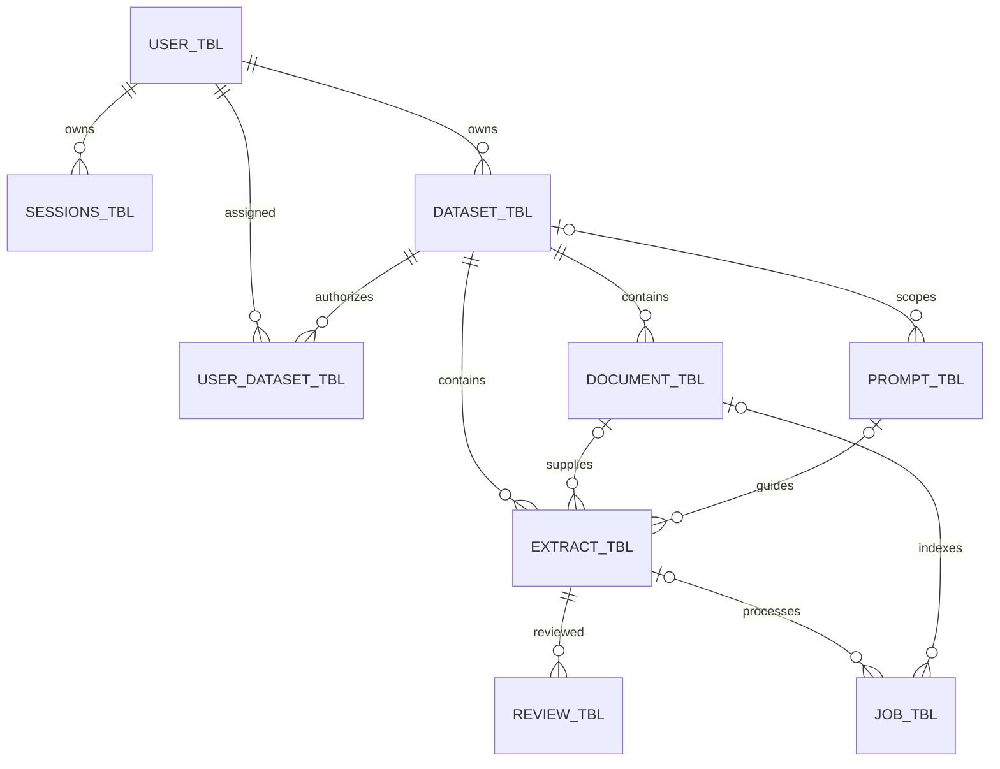
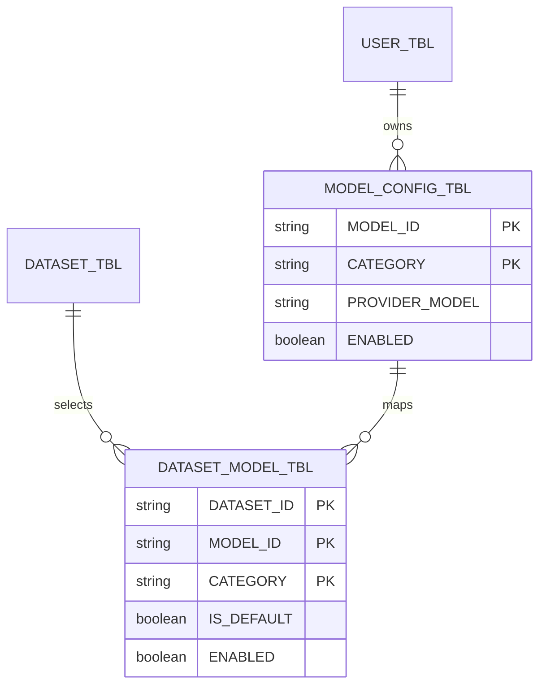

# Aegis database reference

This folder contains the database definitions, inspection queries and setup
reference. The current live installation uses Oracle Autonomous AI Database on
OCI. The supplied `AGS_OWNER` and `FREEPDB1` setup examples describe the separate
local Oracle Free installation. Use the verified [architecture handover](../ags_docs/Aegis_Architecture_and_Deployment_Handover.docx)
and [OCI Kubernetes deployment guide](../ags_docs/Aegis_OCI_Kubernetes_Deployment_Guide.docx)
for the live topology and destination prerequisites.

The application has twelve relational tables in Oracle mode. OCI native vector
storage additionally creates `aegis_knowledge_vectors` through
`ags_backend/ags_app/oracle_vectors.py`, giving thirteen application tables in
that mode. The static SQL installer covers the twelve relational tables;
native `VECTOR` storage is managed separately by the application.

## Files and responsibilities

| Folder or file | Purpose |
| --- | --- |
| `ags_schema/` | Local owner provisioning and read-only owner verification |
| `ags_tables/` | Twelve relational table scripts, foreign keys, checks and indexes |
| `install.sql` | Ordered SQLcl/SQL Developer installation for an empty local schema |
| `generate_tables.py` | Regenerate reviewable Oracle DDL from application metadata |
| `ags_queries/` | Operator inspection queries for workflows, models, users and access |

Schema relationships, roles and the legacy owner migration are maintained below.
Historical local validation results are retained in [Git history](https://github.com/Maniatramco/Aegis/blob/fffaf53259a2bb197267923658411bb36f360aa4/ags_database/ags_docs/VALIDATION.md).
They are a record of the earlier local setup, not the current live OCI inventory.

## Installation and inspection

The application creates its required tables on a fresh installation. For the
optional local SQL installation, connect as `AGS_OWNER` in `FREEPDB1` and run
`@ags_database/install.sql` from the repository root on an empty schema. Oracle
DDL commits implicitly; do not run the fresh installer over existing tables.

`generate_tables.py` writes the SQL files from the application's metadata and
requires backend/Oracle Python dependencies. Review generated changes before
using them. This is a source maintenance tool, not an automatic live migration.

Use `ags_schema/verify_owner.sql` to inspect the connected owner and tables, and
`ags_queries/oracle-queries.sql` for workflow joins. The `Aegis-Local` saved
SQL Developer connection refers to the laptop installation. Database passwords
remain in private credentials, secrets and connection storage.

User access inspection is in `ags_queries/user-dataset-access.sql` and
`ags_queries/user_management.sql`. Application writes enforce session revocation,
audit updates and last-administrator protection; direct SQL updates bypass those
contracts. Existing installations changing the old `AEGIS` owner must use the
[legacy migration procedure](#legacy-owner-migration), rather than changing the
configured username and assuming data will move.

## Tables and keys

| Table | Primary key | Purpose / main fields |
| --- | --- | --- |
| `USER_TBL` | `ID` | Username, password hash, role (user/administrator) and account audit |
| `SESSIONS_TBL` | `ID` | Hashed login token, owner, expiry and CSRF protection |
| `DATASET_TBL` | `DATASET_ID` | Owned dataset, name and status |
| `USER_DATASET_TBL` | `USER_ID, DATASET_ID` | User/dataset assignment, enabled flag and creation/update audit |
| `DOCUMENT_TBL` | `DOCUMENT_ID` | Dataset, filename, merged flag, storage reference, bytes and status |
| `PROMPT_TBL` | `PROMPT_ID` | Filename, version, schema reference, owner and optional dataset |
| `EXTRACT_TBL` | `EXTRACT_ID` | Dataset, document, prompt/version, result/version, status and error |
| `REVIEW_TBL` | `REVIEW_ID` | Extraction, reviewed input version, saved review version and result reference |
| `JOB_TBL` | `ID` | Indexing/extraction task, target, status, progress, attempts, lease and error |
| `MODEL_CONFIG_TBL` | `MODEL_ID, CATEGORY` | Model name, provider model, category, configuration reference, version and enabled flag |
| `DATASET_MODEL_TBL` | `DATASET_ID, MODEL_ID, CATEGORY` | Dataset/category model mapping, enabled and default flags |
| `AEGIS_ITEMS` | `ID` | Internal entity catalog: kind, owner, parent, reference, status and version |

Core account/session/job keys retain the physical column name `ID` to preserve
existing application interfaces. Workflow entity IDs equal their catalog IDs;
they are not new IDs invented during migration. There is no separate `records`
table in AGS_OWNER: that legacy catalog is now `AEGIS_ITEMS`.

## Workflow relationships



Oracle enforces these foreign keys. Each owned workflow entity also references
`USER_TBL.ID`. Dataset/document/prompt/extraction/model configuration IDs reference
their catalog entry, with cascade deletion of their projection when that catalog
entry is deleted. The catalog's general `PARENT_ID` remains a compatibility field;
named workflow tables provide actual dataset foreign keys.

Global prompts have a NULL dataset. Document deletion sets extraction/job document
links to NULL while preserving historical extraction/job IDs. Prompt deletion sets
the extraction prompt link to NULL. Extraction deletion removes its reviews and
clears job extraction links. A job can have at most one of `DOCUMENT_ID` and
`EXTRACT_ID`; both may be NULL for deleted or historical targets. `TARGET_ID`
retains the original target string.

## Dataset permissions

`USER_DATASET_TBL` is a many-to-many mapping. Accounts with
`USER_TBL.ROLE = 'administrator'` manage accounts, assignments and dataset/model
configuration and access every dataset. Ordinary users see only enabled
assignments. Role changes preserve explicit assignments, revoke affected sessions,
and cannot remove the last administrator. Assigned users share dataset documents, scoped prompt templates,
extraction results, reviews and workflow jobs. Conversations and Agent plans
remain private to their creator and require continuing access to their dataset.
Global prompts remain owner-scoped.

Uploads and extraction jobs use the dataset's storage owner so model workers and
vector indexes stay consistent. `CREATED_BY` records the authenticated uploader
or requester, rather than treating the storage owner as the person who acted.
Each assignment has the standard creation/update timestamps, actor foreign keys
and source fields. Revocation disables a row without losing its creation audit;
reassignment enables that same row. Startup only grants legacy owners access
when the mapping table is first introduced, never after an administrator revokes it.

## Model configuration and dataset mapping



`CATEGORY` is constrained to `chat`, `extraction` or `embedding`. A registered model
supporting chat and extraction has two category rows with the same model ID.
The composite mapping foreign key requires the category to exist on that model.
The application validates ownership, availability and defaults when mapping
models to a dataset. One-default-per-category is an application rule, not a
database unique constraint. Removed capabilities remain disabled so historical
mapping references do not break. Query both mapping and model enabled flags when
checking availability. Provider endpoints, credentials and advanced options
remain in the referenced configuration/secret storage, not duplicated in this table.

## Audit columns on every table

| Column | Meaning |
| --- | --- |
| `CREATED_AT` | Creation time, Unix epoch seconds (`BINARY_DOUBLE`) |
| `CREATED_BY` | Account ID, nullable foreign key to `USER_TBL.ID` |
| `UPDATED_AT` | Most recent application update time, Unix epoch seconds |
| `UPDATED_BY` | Account on whose behalf the update ran, nullable foreign key |
| `CREATED_VIA` | Source such as `api`, `worker`, `operator`, `legacy` or `migration` |
| `UPDATED_VIA` | Source of the latest update |

Application transactions maintain audits and named workflow projections together.
Worker updates identify the owning account and `worker` source; they do not imply
that the user manually performed each background step. Operator account
provisioning has an unknown actor (NULL), rather than crediting the new account
for its own creation. Historical creators/updaters were never recorded and remain
NULL. Legacy account/session timestamps mark import time, not a recovered creation
date. Known review actors/times are recovered from saved review JSON.

These are application audit hooks, not database triggers. Direct SQL edits do not
automatically populate audits, update JSON payloads or rebuild vector indexes.
Use the application for writes; use the supplied SQL to inspect data. The audit
columns identify current creation/update metadata, not a full event history.

## Extraction, merging and review history

`EXTRACT_ID` tracks a logical extraction; re-extraction increments its version and
creates another background job under the same ID. Independent extraction creates
one extraction ID per document. Single extraction of multiple files creates a
real merged document with its merged filename. `DOCUMENT_TBL.IS_MERGED` marks it;
the extraction links to that merged document and preserves all original source
IDs, names and merge details in its versioned JSON.

Older combined selections without a physical merged document have a NULL
extraction `DOCUMENT_ID`, rather than misleadingly linking the first source.
Their original source list remains in the retained result JSON. Merge membership
is not represented by a separate relational join table in this implementation.

Extraction status is the entity's state (`queued`, `ready`, `failed`); job status
and progress describe current processing (`queued`, `running`, `completed`,
`failed`, `cancelled`). Inspect both tables to distinguish pending data from a
running task. Status strings follow the existing application lifecycle.

Each saved review has a separate UUID `REVIEW_ID`. The unique pair
`EXTRACT_ID, REVIEW_VERSION` prevents duplicate history rows. `EXTRACTION_VERSION`
identifies the version reviewed; `REVIEW_VERSION` is the resulting saved JSON
version, not a sequential review count. Example: extraction v1, review v2,
re-extraction v3, second review v4. Review result references retain their individual
JSON versions instead of replacing earlier reviewed content.

## SQL and content storage

Oracle stores workflow metadata, relationships, statuses, references and audits.
Original/merged files, prompt schemas, extracted field values, citations, merge
source lists and review JSON remain in persistent application storage (or the
configured OCI Object Storage). The current OCI installation stores vectors in
Oracle Autonomous AI Database through the separate `aegis_knowledge_vectors` table.
Qdrant belongs to the alternative local/self-hosted configuration. The twelve
relational scripts in `ags_tables/` do not create the native vector table or store the full
extracted fields.

`AEGIS_ITEMS` and versioned payloads remain the application's compatibility source;
the named tables are transactionally maintained relational views of those entities,
implemented as physical tables. Writing projection tables directly does not update
the catalog. Native SQLite retains legacy core names to preserve existing native
workspaces. The `AGS_OWNER` setup examples target local Oracle Free; the live
Autonomous Database connection is configured separately.

Exact column definitions, constraints and indexes are in `ags_database/ags_tables/*.sql`.
The query file shows joins and readable time conversion without selecting
password hashes, session/CSRF tokens or provider secrets.

## User roles

`USER_TBL.ROLE` is required, defaults to `user`, and accepts `user` or `administrator`. `ags_tables/01_user_tbl.sql` describes fresh installation; do not run the fresh install script over existing tables.

API and worker startup automatically add the role column to legacy installations and promote the existing account with ID `administrator` once. Restarting after an intentional demotion does not restore its role. Existing account IDs, passwords, sessions, ownership, dataset assignments and result references are retained. Updating roles through the application revokes affected login sessions and writes account audit metadata. The API locks account rows when changing roles to prevent simultaneous demotions from removing the last administrator.

Any existing administrator can use **Manage workspace > Users & passwords > Change role** and confirm using their own password. Use the application rather than direct SQL updates, which bypass session revocation and last-administrator protection.

Read-only inspection:

```sql
SELECT id, username, role, created_at, updated_at, updated_by, updated_via
FROM ags_owner.user_tbl
ORDER BY username;

SELECT role, COUNT(*) AS account_count
FROM ags_owner.user_tbl
GROUP BY role;
```

See [the account guide](https://github.com/Maniatramco/Aegis/blob/a33d5fba9e5c9c62319bb65c42a0341eed8de238/ags_docs/ags_guides/USER-MANAGEMENT.md) and [the relational model](#tables-and-keys). No additional application table or container is required.

## Legacy owner migration

This is a one-time copy, not a rename or destructive move. The source `AEGIS`
schema is retained. Application users, password hashes, sessions, IDs, versions,
timestamps, status/error fields and storage references are compared exactly before
the target transaction commits. Actual row contents and credentials are not logged.

1. Finish/cancel active jobs and stop application writes. Stop web, API and worker.
2. Create `AGS_OWNER` using the Oracle startup script or `ags_database/ags_schema/create_owner.py`.
3. Build the updated backend image and run the migration against an **empty** target:

```powershell
docker compose --project-directory . --env-file .env.oracle -f ags_local_use/compose.oracle.yaml -f ags_local_use/compose.gpu.yaml -f ags_local_use/compose.oracle-client.yaml build api worker
docker compose --project-directory . --env-file .env.oracle -f ags_local_use/compose.oracle.yaml -f ags_local_use/compose.gpu.yaml -f ags_local_use/compose.oracle-client.yaml stop web api worker
docker compose --project-directory . --env-file .env.oracle -f ags_local_use/compose.oracle.yaml -f ags_local_use/compose.gpu.yaml -f ags_local_use/compose.oracle-client.yaml run --rm --no-deps api python -m ags_app.migrate_owner --source AEGIS
docker compose --project-directory . --env-file .env.oracle -f ags_local_use/compose.oracle.yaml -f ags_local_use/compose.gpu.yaml -f ags_local_use/compose.oracle-client.yaml up -d --no-deps --wait api worker web
```

Omit the GPU override for CPU machines. The migration implementation lives in
`ags_backend/ags_app/migrate_owner.py` so the identical API image can run it under Docker
or as a Kubernetes maintenance Job, with the same storage and secrets mounted.
It refuses a nonempty target or active jobs. Oracle DDL can leave empty tables
after failure; the data-copy transaction itself rolls back on verification errors.
Review rows are backfilled from retained reviewed JSON versions.

Fresh installations create the new schema directly; they do not need this copy.
Do not rerun it against the live migrated schema. There is no automatic migration
of an existing Oracle cluster during startup.

The old owner is a snapshot, not a continuously synchronized rollback database.
Before rolling back after new writes, plan how to retain those writes. Immediately
after migration, rollback can restart the **previous backend image** with its
previous `ORACLE_USER=AEGIS` configuration and unchanged storage. The new image
uses renamed tables and must not be pointed at the old schema as a rollback.

Historical `created_by` / `updated_by` were not recorded and remain NULL, with
`created_via=legacy` and `updated_via=migration`. Legacy accounts/sessions had no
creation timestamps; their new audit timestamps mark import time. Historical
review actors/times are recovered from review JSON when available.
