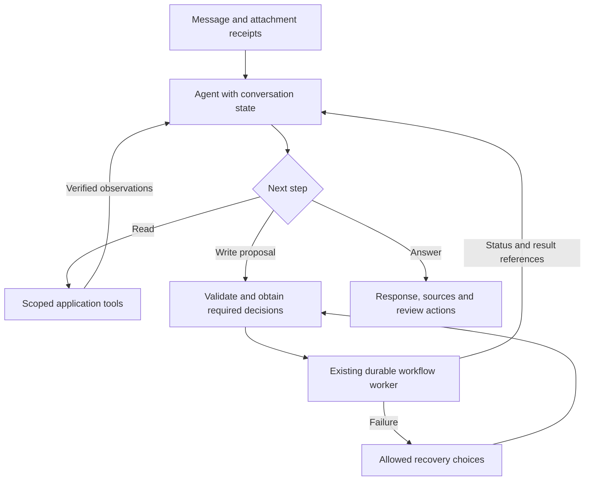

# Aegis agent workflow redesign

Research date: 10 October 2026. Status: architecture recommendation; not implemented or benchmarked.

## Recommendation

Replace the phrase router and disconnected planner/answer calls with one stateful, tool-using conversational agent. Embed LangGraph in the existing Python backend, use native Ollama tool calling for the local model, and retain Oracle, Qdrant, the extraction worker, and the current review UI.

The model should interpret requests, select application tools, inspect their results, and explain the outcome. Application code should enforce ownership, validate inputs, record approvals, execute jobs, and generate review actions. This is one assistant with a controlled execution pipeline. General conversation, document knowledge, and saved extraction results should share conversation state.

This recommendation is based on Aegis's need for persistent follow-ups, conditional requests, long extraction jobs, user decisions, and recovery. A framework supplies orchestration; it does not make an untested local model reliable by itself.

## What is wrong in the current implementation

Repository inspection found these boundaries:

| Current component | Observed behavior | Consequence |
|---|---|---|
| `backend/app/agent_workspace.py` | Planner action vocabulary is `upload`, `extract`, and `reextract`; phrase guards precede the model-generated plan | No general read-tool mechanism for querying extraction results, reviews, or job state |
| Planner context | Catalog and compact workspace counts; recent user questions | Follow-ups lose assistant answers and application observations; state assumptions can be unverified |
| Reply dispatch | Chooses general or document answering; application context is supplied to the general branch | A document answer does not automatically know what Aegis has already done |
| Document answering | Retrieves document excerpts and asks the model to answer from those excerpts | PDF contents cannot establish whether an extraction job completed |
| Existing worker/storage | Oracle-backed jobs and versioned artifacts already exist | Useful execution infrastructure is present, but the assistant cannot consistently inspect it |

The reported request, “if it is already extracted just to do a summarise,” illustrates the problem. The saved planner treated it as a summary, while the answer stage used document evidence and said extraction could not be confirmed. The earlier inspection found a ready extraction in that dataset. This is an application-state and information-flow defect, not evidence that another phrase rule would solve conversation understanding.

## Research findings and framework choice

The findings below describe documented capabilities. The suitability judgments are recommendations for Aegis, not measured framework benchmarks.

| Option | Documented capability | Aegis assessment |
|---|---|---|
| **LangGraph — recommended** | Stateful orchestration, checkpoints, streaming, and pauses for external input; usable without the LangChain framework [1][4] | Strong fit for a conversation that enters an approved workflow, waits for jobs, and resumes after failures |
| Pydantic AI | Typed tools and outputs, Ollama support, deferred tool execution; durable execution integrations are separate from ordinary conversation storage [5][6] | Good alternative for a smaller tool loop. Would still need deliberate integration with Oracle and existing jobs |
| OpenAI Agents SDK | Custom and OpenAI-compatible model providers; non-OpenAI endpoint compatibility must be considered [7] | Viable, but requires additional provider and persistence evaluation for this local-first deployment |
| Continue the custom router | Existing code and no new orchestration dependency | Lowest initial change, but Aegis would continue owning the entire tool loop, checkpoint, replay, and approval implementation |

Oracle's official integration repository provides `langgraph-oracledb`, including synchronous and asynchronous Oracle checkpoint savers and an optional long-term store [2]. This is a concrete path to retaining Oracle for graph persistence; installing PostgreSQL is not necessary for this design. Package compatibility, DDL, privileges, and restart behavior still need testing against Aegis's Oracle Free instance and schema conventions.

Ollama documents structured tool calls and an iterative loop: provide tool definitions, execute selected calls, append tool results to the conversation, and invoke the model again [3]. Aegis should use that interface rather than asking for a complete action plan and then switching to an unrelated answering prompt. Whether the installed Qwen3:4b reliably chooses tools and uses observations is an evaluation question.

The OpenAI SDK documentation also describes tracing behavior and non-OpenAI provider differences [7]. For any chosen framework, Aegis's local mode should explicitly use local inference and local diagnostics; hosted tracing or inference should require separate configuration.

## Proposed architecture

The graph is an orchestration library inside existing services. It does not require another agent server or a fleet of agents. Keep the long-running extraction work in the worker. The conversational loop should return when a job starts and resume from job events or the next user message, rather than repeatedly calling the model while waiting.

### Application tools

Start with a small domain-oriented tool set. These names are proposed contracts, not existing endpoints.

| Tool | Required result and behavior |
|---|---|
| `resolve_documents` | Resolve uploaded receipts, explicit document references, or the current workflow's document set; return ambiguity when multiple interpretations remain |
| `search_documents` | Search only the permitted dataset/document scope; return excerpts with source references for document questions |
| `find_extractions` | Return matching extraction IDs, coverage, input/template versions, status, and review availability |
| `read_extraction_results` | Read requested saved results, with pagination, all entities, source provenance, and explicit original/reviewed version |
| `get_workflow_status` | Return actual job phase, completed/failed items, and permitted next actions |
| `prepare_workflow` | Validate prompt uploads or extraction requests and return a proposal/decision requirements; do not commit mutations |
| `submit_workflow` | Consume an approved, server-issued proposal and submit validated work once; return workflow, job, and extraction references |
| `recover_workflow` | Execute only allowed retry, cancel, or continue-with-ready-items actions for the current failure |

Preload a compact, trusted workspace snapshot each turn: selected dataset, active upload receipts, selected prompt/version, document scope, and recent workflow/extraction references. Refresh changing status through tools. Do not paste the entire database, all schemas, and every document into each model request.

The server derives identity and permissions from the authenticated session. Every tool enforces dataset ownership independently. The model receives neither database credentials nor unrestricted SQL or shell tools. Review buttons come from validated backend result references, not URLs invented in generated text.

### Conversation state and reference resolution

Persist user and assistant messages, tool calls and observations, attachment metadata, prompt-save receipts, workflow IDs, extraction IDs, and unresolved decisions together. Client input should carry message text and upload handles; the server retrieves authoritative state.

Resolve “this” or “it” using explicit references, current attachments, current selection, and the last relevant workflow. Ask a concise clarification if competing candidates remain. A dataset switch changes the active scope; it must not silently reuse another dataset's prompt or document references.

This would prevent an uploaded prompt from becoming invisible once it leaves the composer. The saved receipt should identify its dataset, filename, prompt ID, and version. A later “update this” can operate on that reference, subject to the requested change and existing confirmation rules.

### Expected behavior for the reported request

For “if it is already extracted, summarize it,” the agent should:

1. Resolve the intended document set from the current conversation.
2. Query matching saved extractions and verify status and coverage. Do not infer completion from an earlier assistant statement.
3. If successful results cover the intended set, read those results and summarize them with extraction IDs and a Review action. Identify whether reviewed or original values were used.
4. If only some results exist, disclose the missing or failed items, summarize available results if appropriate, and offer permitted next steps.
5. If a job is running, show its real phase. If no extraction exists, explain that and prepare an extraction proposal rather than pretending it has completed.

A request to summarize raw documents may use document search instead. The answer should make its evidence source clear. Application status comes from application tools; document facts come from source documents or saved extracted values.

## Upload, merge, extract, and review

Preserve the user's desired end-to-end flow and make its decisions explicit in a typed proposal:

- Show submitted files with the sent message; keep composer clearing and upload receipts consistent.
- For JSON, validate syntax and the supported prompt schema, then resolve prompt-versus-document use when needed. Validation errors should identify the failing location and correction needed. Ordinary supported documents do not need this classification question.
- For multiple documents, ask **single combined extraction or independent extractions**. Record the choice with the source list and template version.
- For a combined extraction, create a real merged artifact with its own filename and document ID, preserve every original, and record the ordered source manifest. The review screen must show the merged artifact and original-file choices.
- Distinguish combining files about one entity from extracting several entities. Multiple resumes require a collection of profiles, not one scalar `full_name`. If the selected template only describes one profile, propose a visible collection schema or ask the user to choose independent extraction. Never silently drop people to fit a schema.
- Return a trackable extraction ID for every extraction. A combined extraction also links its individual entities to original sources; independent extractions each retain their own IDs and statuses.
- On completion, show entity count, source coverage, extraction IDs, actual result state, and Review actions. Missing evidence remains marked as unverified.

The assistant interprets the request. Deterministic code owns file handling, schema validation, merge manifests, job submission, status transitions, and result integrity.

## Durability, approvals, and failure handling

LangGraph supports persisted pauses and resumption, but an interrupted node starts again from its beginning when resumed [4]. Place approvals before side effects and keep mutations in separate, idempotent steps. Do not equate a saved checkpoint with exactly-once external execution.

Bind a confirmation to the authenticated owner, dataset, source IDs and versions, prompt version, extraction mode, and proposal fingerprint. A stale or modified proposal requires validation again. Approval is separate from authorization.

Retain the existing job ledger and worker leases. Scope an idempotency key to a workflow/action/input fingerprint: a retry of the same submission returns the existing job references. An explicitly requested new extraction receives a new run identity. Reconcile committed jobs/results after a crash between a side effect and a graph checkpoint.

Return typed failures containing stage, affected files, retryability, preserved successful outputs, and allowed recovery actions. Examples:

| Failure | User-facing recovery |
|---|---|
| Invalid JSON/schema | Show validation detail; replace or correct the prompt |
| Upload/index failure | Retry failed files or continue with ready files after scope confirmation |
| Prompt cannot represent multiple entities | Choose independent runs or approve a collection template |
| Context too large | Process through bounded extraction units or reduce scope; disclose coverage and any limits |
| Model unavailable/timeout | Preserve references and progress; retry when ready or cancel |
| Partial extraction | Review completed results and retry failed items |

Large input handling belongs in the extraction pipeline. For collections, processing each entity/source in bounded units and aggregating validated outputs can preserve all profiles without sending every page in one model request. One entity spread across many files requires a different consolidation strategy with provenance and conflict handling. No strategy should silently truncate input to make a context-budget error disappear.

Replace indefinite “Thinking” with real stages such as “Checking saved results,” “Indexing 3 files,” “Extracting item 2 of 3,” and “Ready for review.” Stream durable events and support reconnecting without restarting work. Record tool names, timings, and result references for diagnostics; internal model reasoning need not be displayed or stored.

## Oracle and deployment compatibility

Keep the existing business model, including `DATASET_TBL`, `DOCUMENT_TBL`, `PROMPT_TBL`, `EXTRACT_TBL`, `REVIEW_TBL`, `JOB_TBL`, and model/dataset configuration. `SESSIONS_TBL` remains authentication sessions, not conversation memory.

Evaluate the official Oracle checkpointer in an isolated test schema first. Inspect its DDL, migration behavior, required privileges, table naming, and compatibility with the requested audit conventions before applying anything to `AGS_OWNER`. Do not predict an exact new table count before inspecting the pinned package. Place reviewed migration artifacts and the revised relationship diagram under `database/`.

Application conversation/run/approval/event metadata needs ownership and dataset relationships plus `created_at/by/via` and `updated_at/by/via`. Existing `AEGIS_ITEMS` can support an initial compatibility phase; explicit business tables can follow a reviewed migration. Framework checkpoints and business audit records have different purposes. Preserve versioned result artifacts and Qdrant vectors rather than moving them merely because a new persistence package exists.

Use the same images and environment-based configuration for Docker and Oracle Kubernetes. Embed orchestration in the existing API/worker; do not require a new cloud inference service. Apply schema migrations as a controlled deployment step. Dependency or model-readiness failures should have actionable messages.

CPU remains supported; an accessible compatible GPU is optional. Orchestration must not depend on CUDA. Keep the current hardware-selection setup, and test the agent using the model actually accessible from the container. Separate model-call counts and CPU timings from GPU timings.

The existing Kubernetes pilot uses shared filesystem artifacts and a single API/worker Pod. Checkpointing does not remove that scaling restriction. Multiple replicas would require deliberate changes to shared/object storage and concurrency control. Restart/resume and deployment behavior need actual cluster validation; research alone cannot establish OKE readiness.

## Evaluation and rollout

Tool evaluation should use realistic tasks and evaluate outcomes rather than demand one exact tool-call sequence [8]. Build a held-out set of at least 50 varied requests, including misspellings and short follow-ups, alongside deterministic integrity tests. Avoid training a growing phrase list against the same examples used for acceptance.

| Acceptance scenario | Required observation |
|---|---|
| Conditional summary: complete extraction | Reads saved results; summarizes every intended entity; no new extraction |
| Conditional summary: missing/pending/partial | Accurately distinguishes states and offers valid choices |
| Attached prompt followed by “update this” | Uses the attachment/save receipt and correct dataset/version |
| Three resumes, combined | All three profiles retained; merged filename/manifest and extraction ID visible |
| Three resumes, independent | Three individually trackable results and statuses |
| Invalid JSON/schema | Actionable validation; no incorrect prompt save |
| Dataset switch or inaccessible ID | No cross-dataset/user result or prompt leakage |
| Duplicate submission / restart after commit | No duplicate job caused by confirmation replay |
| Crash while awaiting a decision or worker result | Correct persisted conversation and workflow resume |
| Context pressure / timeout / partial failure | No silent data loss; preserved progress and tested recovery |
| Reviewed results changed | Summary identifies the chosen version; conflicts are handled |
| CPU-only and optional GPU containers | Same functional assertions; timings reported separately |

Measure task success, unsupported factual/state claims, unintended writes, entity/source coverage, clarification rate, invalid tool arguments, model-call counts, tokens, and median/p95 latency. Measure first progress event, read-only answer completion, and extraction completion separately. Framework adoption is not a latency benchmark.

Proposed release gates: every deterministic ownership, version, replay, and completeness case passes; no observed unintended writes in the evaluation suite; at least 95% task success on the held-out semantic cases. These are targets, not achieved results, and do not establish correctness for all possible requests.

Implement in stages:

1. **Read-only proof:** native tool loop, workspace snapshot, saved-result/status tools, unified conversation. Reproduce the user's conditional-summary case and its paraphrases. Prove Oracle checkpoint restart behavior.
2. **Approved workflows:** connect existing upload/extract pipeline through typed proposals, attachment receipts, merge decisions, and validated UI actions. Add idempotency and crash reconciliation tests.
3. **Recovery and budget tests:** failures, long CPU jobs, bounded contexts, multi-entity completeness, cancellation, and stale proposals.
4. **Deployment verification:** rebuild Docker images; run real upload → extract → review; validate CPU startup and optional GPU access; run restart tests. Validate the same artifacts on OKE when cluster access is available.

Use a feature flag and keep the current workflow endpoints available during rollout. Do not run both routing systems on the same submitted action or create duplicate jobs. Remove phrase-based semantic routing after the new path passes acceptance; retain deterministic validation and explicit UI actions.

## What this research has and has not established

Established: current source boundaries explain the reported state mismatch; the proposed runtime and Oracle persistence integration are documented; the existing application components can be retained in the design.

Not established: installed-model tool-selection accuracy, compatible pinned dependency versions, checkpointer DDL/audit compatibility, restart/replay correctness, new CPU/GPU timings, or successful Oracle Kubernetes deployment. No dependency, schema, runtime, or application behavior was changed as part of this research report.

## Primary sources

1. [LangGraph overview](https://docs.langchain.com/oss/python/langgraph/overview) — standalone orchestration and stateful capabilities.
2. [Oracle's official LangChain/LangGraph integrations](https://github.com/oracle/langchain-oracle) and [Oracle checkpointer guide](https://github.com/oracle/langchain-oracle/blob/main/libs/langgraph-oracledb/README.md) — Oracle checkpoint savers and setup.
3. [Ollama tool calling](https://docs.ollama.com/capabilities/tool-calling) — native tool definitions, observations, and iterative calls.
4. [LangGraph interrupts](https://docs.langchain.com/oss/python/langgraph/interrupts) — pause/resume semantics and replay considerations.
5. [Pydantic AI overview](https://pydantic.dev/docs/ai/overview/) — typed agent tools and provider support.
6. [Pydantic AI durable execution](https://pydantic.dev/docs/ai/capabilities/durable_execution/overview/) — durability integrations and distinction from message persistence.
7. [OpenAI Agents SDK model providers](https://openai.github.io/openai-agents-python/models/) — non-OpenAI providers, compatibility, and tracing configuration.
8. [Anthropic: writing effective tools](https://www.anthropic.com/engineering/writing-tools-for-agents) — tool contracts and realistic evaluation.

All external sources accessed on 10 October 2026. Design choices, rollout sequence, proposed tool names, and acceptance thresholds are Aegis recommendations rather than source claims.
